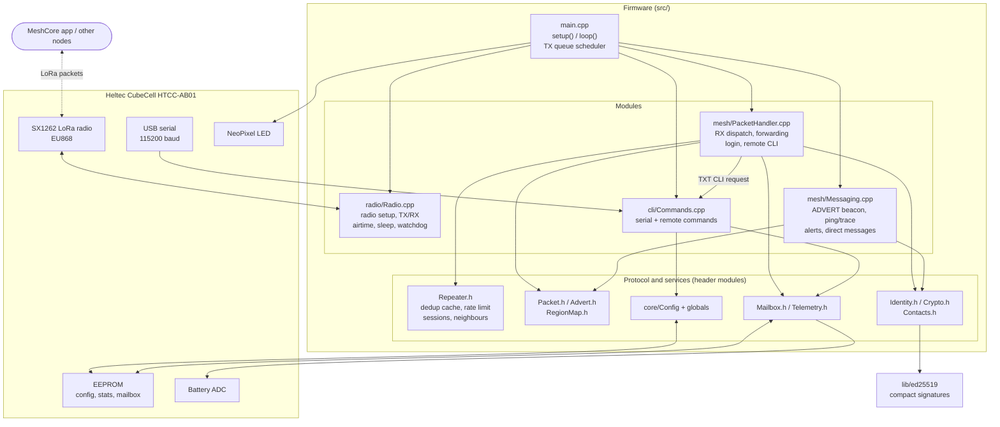

# CubeCellMeshCore

MeshCore-compatible LoRa repeater firmware for the **Heltec CubeCell HTCC-AB01** (ASR6501, SX1262).
It joins an existing MeshCore network, forwards traffic and can be managed from the MeshCore apps or over USB serial.

**Current release:** [v0.8.0](CHANGELOG.md#v080-2026-11-14) · **License:** MIT

## Features

- **MeshCore repeater** — flood and direct routing, 1/2/3-byte path hashes, TRACE, duplicate cache, loop detection, region filtering, `flood.max` hop limit for ADVERTs
- **App integration** — login (admin/guest), remote CLI, telemetry, neighbours list, works with the MeshCore Android/iOS apps
- **Ed25519 identity** — signed ADVERTs with time sync; compact implementation that fits in 128 KB Flash
- **Store-and-forward mailbox** — holds messages for offline nodes and re-delivers them when they return
- **Health monitor** — alerts when nodes go offline or links degrade
- **Protection** — rate limiting (login, requests, forwarding), circuit breaker for bad links, remote admin login refused while the default password is set
- **Low power** — deep sleep with duty-cycled RX, adaptive TX power
- **Persistent state** — configuration, identity and lifetime statistics in EEPROM

## Hardware

| | |
|---|---|
| Board | Heltec CubeCell HTCC-AB01 |
| MCU | ASR6501 SiP — ARM Cortex-M0+ @ 48 MHz with integrated SX1262 |
| Memory use | Flash 88.5 % of 128 KB (~15 KB free) · RAM 52 % of 16 KB |

Default radio profile (EU868, MeshCore "EU/UK Narrow"): **869.618 MHz, BW 62.5 kHz, SF8, CR 4/8, 21 dBm, sync word 0x12**.
US and AU/NZ profiles are selectable in `src/main.h`; the frequency can also be changed at runtime with `set freq` / `tempradio`.

## Getting Started

### Flash a prebuilt image

Download [`release/firmware.cyacd`](release/firmware.cyacd) and flash it with Heltec CubeCellTool (Windows),
or use [`release/firmware.hex`](release/firmware.hex). See [release/INSTALL.md](release/INSTALL.md).

### Build from source

Requires [PlatformIO](https://platformio.org/).

```bash
pio run                  # build
pio run -t upload        # build and flash
pio device monitor -b 115200
```

On Linux, install [`tools/99-cubecell.rules`](tools/99-cubecell.rules) in `/etc/udev/rules.d/` to access the CP210x port without root.

### First configuration

Connect at 115200 baud and run:

```
set name MyRepeater
set lat 45.4408
set lon 12.3155
password admin <new-admin-password>
password guest <guest-password>
save
```

Until the admin password is changed from the default, remote admin login is disabled.

> **Upgrading from 0.7.x or earlier:** the EEPROM layout changed in 0.8.0, so settings reset to defaults on first boot. The node identity is preserved.

## Commands

The CLI follows MeshCore naming (`get`/`set name`, `set tx`, `password`, …); older names remain as aliases.
Commands are available on the serial console and, after login, remotely from the app.

| Area | Examples |
|---|---|
| Status | `status`, `stats`, `lifetime`, `health`, `telemetry` |
| Network | `nodes`, `neighbours`, `contacts`, `ping`, `advert` |
| Repeater | `set repeat on/off`, `set flood.max <n>`, `region`, `ratelimit` |
| Radio & power | `radio`, `set tx <dBm>`, `set tx auto on/off`, `mode 0/1/2`, `sleep on/off` |
| Security | `password admin/guest`, `acl`, `identity` |
| System | `save`, `reboot`, `erase`, `help` |

Full reference: [release/COMMANDS.md](release/COMMANDS.md) · Guides: [English](docs/CubeCellMeshCore_Command_Guide_EN.html), [Italiano](docs/CubeCellMeshCore_Guida_Comandi_IT.html)

## Architecture



Received packets are handled in `processReceivedPacket()`: requests addressed to this node (login, CLI, discovery, ping) are answered directly;
everything else passes `shouldForward()` (region filter, duplicate cache, hop limits, loop detection) and the forward rate limit,
then waits in the TX queue for an SNR-weighted delay and is sent only if the channel is free.

```
src/
├── main.cpp / main.h       setup(), loop(), build-time configuration
├── cli/Commands.cpp        serial and remote commands
├── radio/Radio.cpp         radio, airtime, sleep, watchdog
├── core/                   config (EEPROM), globals, LED
└── mesh/                   packet handling, messaging, protocol and service headers
lib/ed25519/                compact Ed25519
tools/                      serial tests, host crypto/packet tests, udev rule
docs/                       architecture, API, testing, command guides
release/                    prebuilt firmware and release notes
```

## Testing

```bash
python tools/serial_test.py [/dev/ttyUSB0] [--full]   # on-device tests over serial (needs pyserial)
./tools/test_ed25519_host.sh                         # Ed25519 against the reference implementation
./tools/build_test.sh                                # build verification
```

## Documentation

- [Architecture](docs/ARCHITECTURE.md) · [API](docs/API.md) · [Testing](docs/TESTING.md)
- [Changelog](CHANGELOG.md)

## Credits

Created by **Andrea Bernardi**. Built on the [MeshCore](https://github.com/meshcore-dev/MeshCore) protocol,
[RadioLib](https://github.com/jgromes/RadioLib), [rweather/Crypto](https://github.com/rweather/arduinolibs) and [orlp/ed25519](https://github.com/orlp/ed25519).

Released under the MIT License — see [LICENSE](LICENSE).
